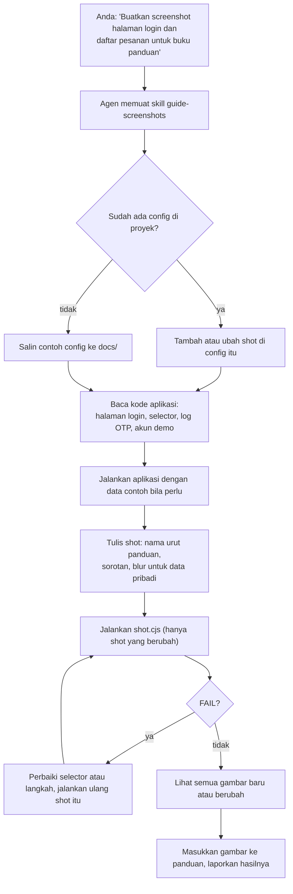

# 5. Dipakai lewat agen AI

[English](use-with-ai-agents.md) · **Bahasa Indonesia**

GuShot juga sebuah Agent Skill. Setelah dipasang, Anda cukup meminta screenshot ke agen AI dengan bahasa biasa, dan agen mengerjakan isi tutorial 1 sampai 4: membaca aplikasi Anda, menulis config, menjalankannya, lalu memeriksa hasilnya.

## Yang dikerjakan agen



Skill ini mengarahkan agen untuk memakai GuShot, bukan memotret manual atau menulis skrip browser sendiri, menyimpan password di variabel environment, dan mem-blur data pribadi.

## Pemasangan

### Claude Code

```
/plugin marketplace add rombyar/gushot
/plugin install gushot@gushot
```

### Codex, GitHub Copilot, Cursor, Gemini CLI

Salin folder skill ke `~/.agents/skills/`, yang dibaca oleh keempatnya:

```bash
git clone https://github.com/rombyar/gushot.git
mkdir -p ~/.agents/skills
cp -r gushot/skills/guide-screenshots ~/.agents/skills/
```

```powershell
git clone https://github.com/rombyar/gushot.git
New-Item -ItemType Directory -Force "$HOME\.agents\skills" | Out-Null
Copy-Item -Recurse gushot\skills\guide-screenshots "$HOME\.agents\skills\"
```

Gemini CLI juga bisa memasangnya langsung:

```bash
gemini skills install https://github.com/rombyar/gushot.git --path skills/guide-screenshots
```

[README utama](../../README.id.md#dipakai-lewat-agen-ai) mencantumkan folder yang dibaca setiap agen dan cara memanggil skill-nya.

## Contoh permintaan

Buka proyek aplikasi Anda di agen, lalu minta:

| Yang Anda mau | Permintaan |
|---|---|
| Screenshot pertama | "Pakai guide-screenshots untuk memotret halaman login, dasbor, dan form pesanan baru untuk buku panduan di docs/panduan.md." |
| Satu langkah dijelaskan dengan nomor | "Screenshot modal pesanan baru dengan kolom pelanggan, menu, jumlah, dan tombol simpan diberi nomor 1 sampai 4." |
| Versi HP | "Tambahkan versi ukuran HP untuk dasbor dan daftar pesanan." |
| Pembaruan setelah desain berubah | "Header-nya berubah. Cek screenshot panduan mana yang rusak atau berubah, lalu perbarui." |
| Sekalian teks panduannya | "Tulis bab pesanan di docs/panduan.md beserta screenshot-nya. Ikuti docs/gaya-panduan.md." |
| Nama file bahasa Indonesia | "Buatkan screenshot halaman login dan dasbor untuk buku panduan, nama file pakai bahasa Indonesia." |

Di Claude Code Anda juga bisa memulai dengan perintah: `/guide-screenshots buatkan screenshot halaman login dan dasbor`.

## Yang perlu dicek setelahnya

- Agen melaporkan berapa shot yang berhasil dan file apa saja yang ditulis.
- Agen memberi tahu kalau mengubah file environment seperti `.env` (misalnya supaya email masuk ke log), lalu mengembalikannya.
- Kalau agen juga menulis teks panduan: nomor langkah cocok dengan penanda, dan nama tombol yang dikutip sama dengan di layar. Agen mengikuti [writing.md](../../skills/guide-screenshots/references/writing.md) dan file gaya proyek Anda, kalau ada.
- Buka beberapa gambar sendiri: sudah login, tampilan rapi, data pribadi ter-blur.

## Kapan tidak bisa dipakai

Agen harus bisa menjalankan perintah di komputer tempat aplikasi berjalan, atau komputer yang bisa mengaksesnya. Asisten chat yang berjalan di sandbox cloud tidak bisa membuka `localhost` Anda dan tidak punya Chrome. Jenis aplikasi dan login yang bisa ditangani GuShot: [Cocok untuk aplikasi apa](../../README.id.md#cocok-untuk-aplikasi-apa).

Kembali ke [daftar isi dokumentasi](../README.id.md).
