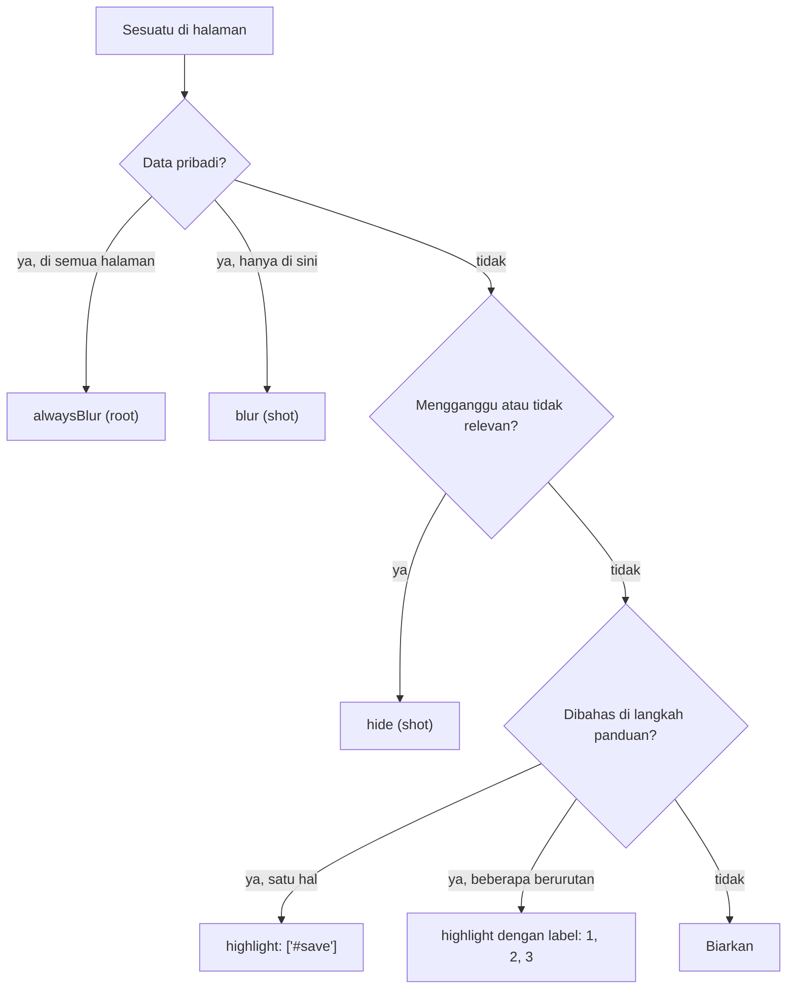
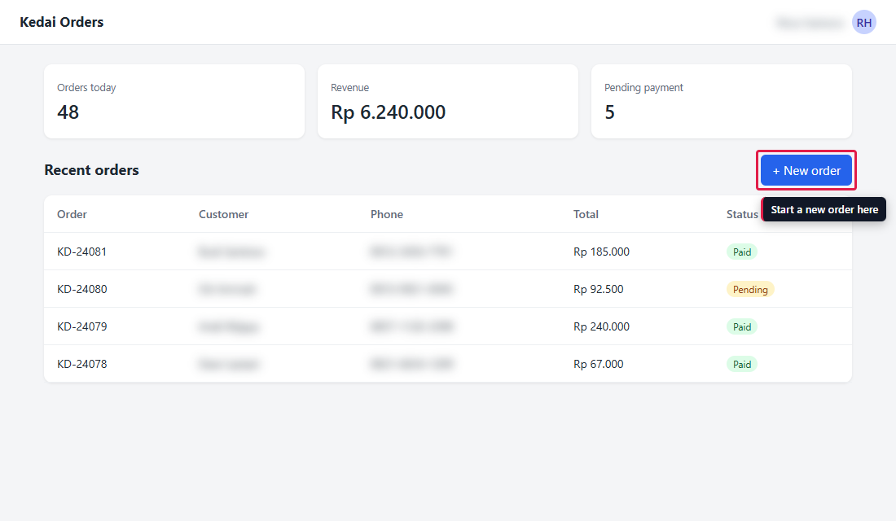
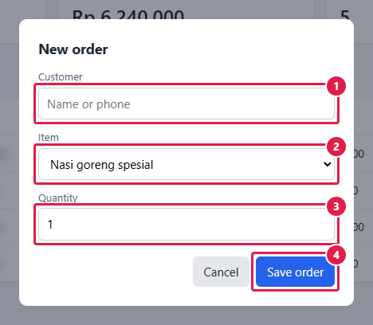

# 3. Blur, sembunyikan, sorot, beri nomor

[English](blur-highlight-numbering.md) · **Bahasa Indonesia**

Screenshot untuk panduan punya dua tugas: menunjukkan ke mana pembaca harus melihat, dan tidak memperlihatkan data pribadi. Tutorial ini membahas kunci untuk keduanya.

## Kunci mana yang dipakai



## Config

[example.json](example.json) login seperti tutorial 2 lalu mengambil tiga shot:

```json
"alwaysBlur": [".customer", ".phone", ".contact"],
"shots": [
  { "name": "01_highlight_button", "session": "admin", "highlight": [{ "selector": "#new-order", "note": "Start a new order here" }] },
  { "name": "02_hide_stats", "session": "admin", "hide": [".stats"], "blur": ["td:nth-child(4)"] },
  { "name": "03_numbered_form", "session": "admin",
    "steps": [{ "click": "#new-order" }, { "wait": ".modal" }],
    "element": ".modal", "padding": 24,
    "highlight": [
      { "selector": "#cust", "label": "1" },
      { "selector": "#menu", "label": "2" },
      { "selector": "#qty", "label": "3" },
      { "selector": ".modal .primary", "label": "4" }
    ] }
]
```

```bash
cd docs/annotations
APP_PASSWORD=demo node ../../skills/guide-screenshots/scripts/shot.cjs example.json
```

## Satu kotak merah, dengan keterangan

`"highlight": ["#new-order"]` menggambar kotak merah di sekeliling tombol. Pakai ini saat panduan berkata "klik New order". Kalau ditulis sebagai objek, sorotan bisa membawa `note`: teks keterangan pendek di bawah kotak (di atasnya kalau kotak dekat bagian bawah layar), supaya gambar tetap bisa dipahami tanpa paragraf di sebelahnya.



## Sembunyikan dan blur dalam satu shot

`"hide": [".stats"]` menghilangkan kartu ringkasan tapi tetap menyisakan ruangnya, jadi tata letak tidak bergeser. `"blur": ["td:nth-child(4)"]` mem-blur kolom Total khusus di shot ini, selain nama dan nomor HP dari `alwaysBlur`.


## Langkah bernomor, hanya modal

`element` hanya memotret modal, `padding: 24` menyertakan 24 px halaman di sekelilingnya supaya pembaca tahu itu jendela dialog, dan setiap `label` menaruh nomor di kotaknya.

**Nomor di gambar harus sama dengan nomor langkah di teks.** Teks panduan untuk gambar ini:

> 1. Di daftar pesanan, klik **+ New order**. Jendela *New order* terbuka.
> 2. Isi nama atau nomor HP pelanggan.
> 3. Pilih menu.
> 4. Atur jumlah.
> 5. Klik **Save order**.

Jadi kolom-kolomnya diberi label `2` sampai `5`, bukan `1` sampai `4`. Langkah 1 terjadi sebelum jendela ini terbuka, jadi tidak punya penanda di gambar ini (langkah itu punya gambarnya sendiri, `01_highlight_button`). Pembaca melihat "langkah 3" di teks lalu menemukan ③ di gambar, tanpa perlu catatan "(penanda 2)".

```json
"highlight": [
  { "selector": "#cust", "label": "2" },
  { "selector": "#menu", "label": "3" },
  { "selector": "#qty", "label": "4" },
  { "selector": ".modal .primary", "label": "5" }
]
```

Config contoh memberi nomor mulai 1 karena hanya memperlihatkan fiturnya; di panduan sungguhan, salin nomornya dari teks Anda.

Dua aturan lagi supaya penanda mudah dibaca:

- Sorot apa yang pembaca lihat sebagai satu kesatuan. Kalau kolom punya ikon atau tombol yang menempel (input group), sorot kelompoknya, bukan `input` di dalamnya.
- Potong ke form atau modal yang dibahas langkah-langkahnya (`element` + `padding`). Pada gambar satu halaman penuh yang dikecilkan supaya muat di dokumen, penandanya jadi terlalu kecil untuk dibaca.



## Tips

- Tetap blur data pribadi walaupun memakai data contoh. Pembaca meniru apa yang mereka lihat.
- `alwaysBlur` cukup ditulis sekali di config; tidak perlu diulang di setiap shot.
- Ganti warna kotak dengan `"highlightColor": "#2563eb"` dan kekuatan blur dengan `"blurStrength": 8`.
- Label bisa berupa teks pendek apa saja: `"A"`, `"2a"`, `"✓"`.
- Buat keterangan sesingkat mungkin. Label dan keterangan bisa digabung: `{ "selector": "#save", "label": "4", "note": "Simpan" }`.
- Di config berbahasa Indonesia, kunci keterangan bisa ditulis `catatan`.

Berikutnya: [4. Menjaga screenshot tetap terbaru](../maintenance/update-after-ui-change.id.md). Untuk memperlihatkan alur saat berlangsung, lihat [6. Merekam alur sebagai video](../video/record-a-flow.id.md).
