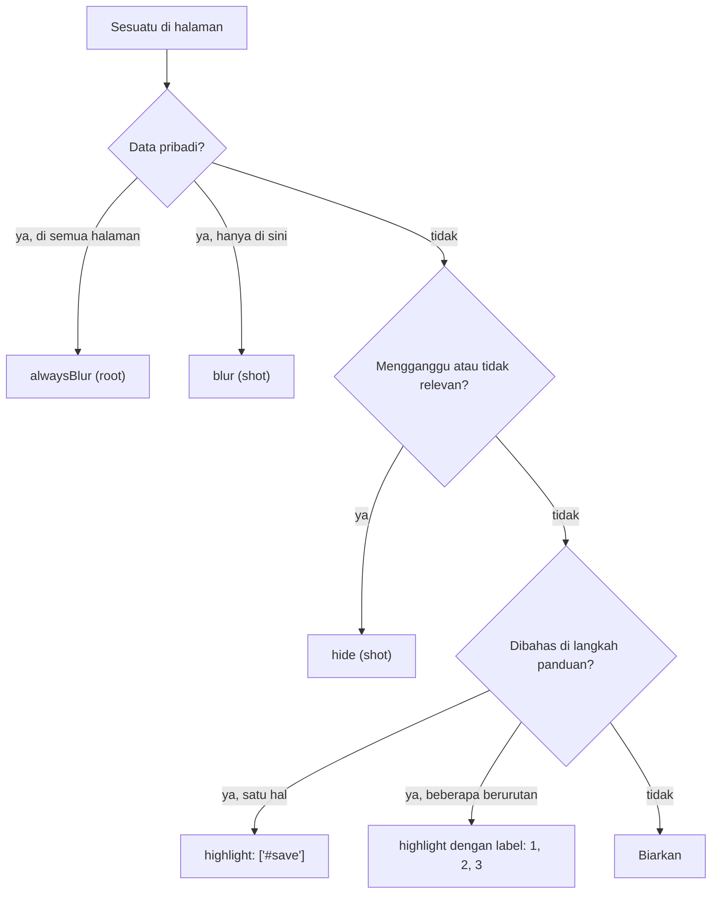

# 3. Blur, sembunyikan, sorot, beri nomor

[English](blur-highlight-numbering.md) · **Bahasa Indonesia**

Screenshot untuk panduan punya dua tugas: menunjukkan ke mana pembaca harus melihat, dan tidak memperlihatkan data pribadi. Tutorial ini membahas kunci untuk keduanya.

## Kunci mana yang dipakai



## Config

[example.json](example.json) login seperti tutorial 2 lalu mengambil tiga shot:

```json
"alwaysBlur": [".customer", ".phone", ".contact"],
"shots": [
  { "name": "01_highlight_button", "session": "admin", "highlight": ["#new-order"] },
  { "name": "02_hide_stats", "session": "admin", "hide": [".stats"], "blur": ["td:nth-child(4)"] },
  { "name": "03_numbered_form", "session": "admin",
    "steps": [{ "click": "#new-order" }, { "wait": ".modal" }],
    "element": ".modal", "padding": 24,
    "highlight": [
      { "selector": "#cust", "label": "1" },
      { "selector": "#menu", "label": "2" },
      { "selector": "#qty", "label": "3" },
      { "selector": ".modal .primary", "label": "4" }
    ] }
]
```

```bash
cd docs/annotations
APP_PASSWORD=demo node ../../skills/guide-screenshots/scripts/shot.cjs example.json
```

## Satu kotak merah

`"highlight": ["#new-order"]` menggambar kotak merah di sekeliling tombol. Pakai ini saat panduan berkata "klik New order".


## Sembunyikan dan blur dalam satu shot

`"hide": [".stats"]` menghilangkan kartu ringkasan tapi tetap menyisakan ruangnya, jadi tata letak tidak bergeser. `"blur": ["td:nth-child(4)"]` mem-blur kolom Total khusus di shot ini, selain nama dan nomor HP dari `alwaysBlur`.


## Langkah bernomor, hanya modal

Teks panduan untuk gambar ini bisa berupa:

> 1. Isi nama atau nomor HP pelanggan. 2. Pilih menu. 3. Atur jumlah. 4. Klik **Save order**.

`element` hanya memotret modal, `padding: 24` menyertakan 24 px halaman di sekelilingnya supaya pembaca tahu itu jendela dialog, dan setiap `label` menaruh nomor di kotaknya.


## Tips

- Tetap blur data pribadi walaupun memakai data contoh. Pembaca meniru apa yang mereka lihat.
- `alwaysBlur` cukup ditulis sekali di config; tidak perlu diulang di setiap shot.
- Ganti warna kotak dengan `"highlightColor": "#2563eb"` dan kekuatan blur dengan `"blurStrength": 8`.
- Label bisa berupa teks pendek apa saja: `"A"`, `"2a"`, `"✓"`.

Berikutnya: [4. Menjaga screenshot tetap terbaru](../maintenance/update-after-ui-change.id.md)
