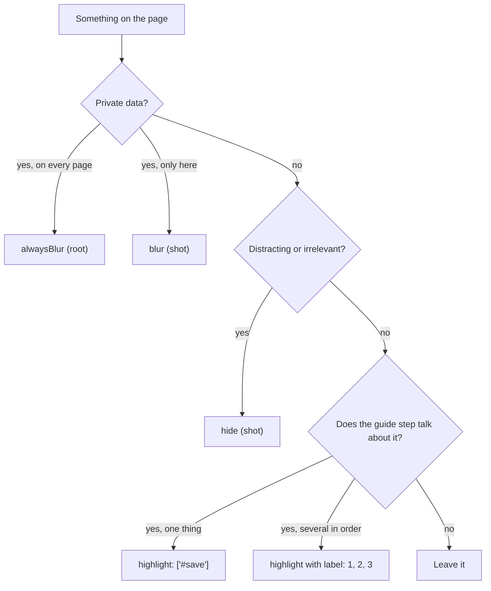

# 3. Blur, hide, highlight, number

**English** · [Bahasa Indonesia](blur-highlight-numbering.id.md)

A guide screenshot has two jobs: show the reader where to look, and show nothing private. This tutorial covers the keys that do both.

## Which key to use



## The config

[example.json](example.json) logs in like tutorial 2 and takes three shots:

```json
"alwaysBlur": [".customer", ".phone", ".contact"],
"shots": [
  { "name": "01_highlight_button", "session": "admin", "highlight": [{ "selector": "#new-order", "note": "Start a new order here" }] },
  { "name": "02_hide_stats", "session": "admin", "hide": [".stats"], "blur": ["td:nth-child(4)"] },
  { "name": "03_numbered_form", "session": "admin",
    "steps": [{ "click": "#new-order" }, { "wait": ".modal" }],
    "element": ".modal", "padding": 24,
    "highlight": [
      { "selector": "#cust", "label": "1" },
      { "selector": "#menu", "label": "2" },
      { "selector": "#qty", "label": "3" },
      { "selector": ".modal .primary", "label": "4" }
    ] }
]
```

```bash
cd docs/annotations
APP_PASSWORD=demo node ../../skills/guide-screenshots/scripts/shot.cjs example.json
```

## One red box, with a note

`"highlight": ["#new-order"]` draws a red box around the button. Use it when the guide says "click New order". Written as an object, it can carry a `note`: a short callout placed below the box (above it when the box is near the bottom of the screen), so the image makes sense even without the paragraph next to it.


## Hide and blur in one shot

`"hide": [".stats"]` removes the summary cards but keeps their space, so the layout does not jump. `"blur": ["td:nth-child(4)"]` blurs the Total column in this shot only, on top of the names and phone numbers from `alwaysBlur`.


## Numbered steps, only the modal

`element` captures only the modal, `padding: 24` keeps 24 px of the page around it so the reader sees it is a dialog, and each `label` puts a number on the box.

**The numbers in the image must be the step numbers in the text.** The guide text for this image:

> 1. On the order list, click **+ New order**. The *New order* window opens.
> 2. Enter the customer's name or phone.
> 3. Choose the item.
> 4. Set the quantity.
> 5. Click **Save order**.

So the fields get labels `2` to `5`, not `1` to `4`. Step 1 happens before this window is open, so it has no marker in this image (it has its own image, `01_highlight_button`). Readers then see "step 3" in the text and find ③ in the picture, without a separate "(marker 2)" note.

```json
"highlight": [
  { "selector": "#cust", "label": "2" },
  { "selector": "#menu", "label": "3" },
  { "selector": "#qty", "label": "4" },
  { "selector": ".modal .primary", "label": "5" }
]
```

The example config numbers from 1 because it shows the feature on its own; in a real guide, copy the numbers from your text.

Two more rules that keep markers readable:

- Highlight what the reader sees as one control. If a field has an icon or a button attached (an input group), highlight the group, not the bare `input` inside it.
- Crop to the form or modal the steps are about (`element` + `padding`). On a full-page image scaled down to fit a document, the markers become too small to read.


## Tips

- Blur what is personal even with sample data. Readers copy what they see.
- `alwaysBlur` belongs in the config once; do not repeat it in every shot.
- Change the box color with `"highlightColor": "#2563eb"` and the blur radius with `"blurStrength": 8`.
- Labels can be any short text: `"A"`, `"2a"`, `"✓"`.
- Keep notes to a few words. A label and a note can be combined: `{ "selector": "#save", "label": "4", "note": "Save" }`.
- In Indonesian configs the note key can be written `catatan`.

Next: [4. Keeping screenshots current](../maintenance/update-after-ui-change.md). To show a flow as it happens, see [6. Recording a flow as a video](../video/record-a-flow.md).
