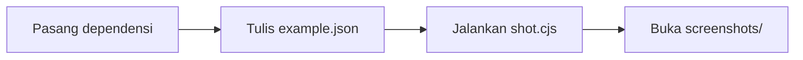

# 1. Screenshot pertama

[English](first-screenshots.md) · **Bahasa Indonesia**

Di tutorial ini Anda memotret halaman login dalam ukuran desktop dan HP. Waktunya sekitar lima menit.



## Sebelum mulai

- Node.js 18 atau lebih baru: `node --version`
- Chrome atau Edge sudah terpasang
- Repo sudah di-clone: `git clone https://github.com/rombyar/gushot.git`

## Langkah 1: pasang dependensi

Dari folder utama repo:

```bash
npm install --omit=dev --prefix skills/guide-screenshots/scripts
```

Perintah ini memasang `puppeteer-core`, yang menjalankan browser yang sudah Anda punya. Tidak ada browser baru yang diunduh.

## Langkah 2: tulis config

Config adalah file JSON. Yang ini adalah [example.json](example.json) di folder ini:

```json
{
  "out": "screenshots",
  "viewport": { "width": 1100, "height": 640 },
  "shots": [
    { "name": "01_login_page", "url": "../../demo/app.html" },
    { "name": "02_login_page_mobile", "url": "../../demo/app.html", "viewport": { "width": 390, "height": 700 } }
  ]
}
```

| Kunci | Arti |
|---|---|
| `out` | folder untuk file PNG, dihitung dari file config |
| `viewport` | ukuran browser untuk semua shot |
| `shots` | daftar screenshot, urut sesuai panduan |
| `name` | nama file tanpa `.png`; beri nomor supaya urut sesuai panduan |
| `url` | halamannya. Di sini file lokal; untuk aplikasi sungguhan pakai `"base": "http://localhost:3000"` di atas dan `"url": "/login"` |
| `viewport` di dalam shot | ukuran lain khusus shot itu |

Kunci juga bisa ditulis dalam bahasa Indonesia (`keluar`, `nama`, ...), lihat [aliases-id.md](../../skills/guide-screenshots/references/aliases-id.md).

## Langkah 3: jalankan

```bash
cd docs/getting-started
node ../../skills/guide-screenshots/scripts/shot.cjs example.json
```

```
OK    screenshots/01_login_page.png (new)
OK    screenshots/02_login_page_mobile.png (new)

Done: 2 OK, 0 failed. Output in .../docs/getting-started/screenshots
Changed: 0, new: 2.
```

## Hasil

| `01_login_page.png` | `02_login_page_mobile.png` |
|---|---|
|  |  |

## Coba juga

- Tambahkan `"fullPage": true` di sebuah shot untuk memotret seluruh halaman sampai bawah.
- Jalankan satu shot saja: `node ... example.json mobile` (bagian mana pun dari nama bisa dipakai).
- Tambahkan `"headless": false` di bagian atas untuk melihat browser bekerja.
- Tambahkan `"scale": 2` di bagian atas supaya gambar tajam di PDF.

## Untuk aplikasi Anda sendiri

Jalankan aplikasi dengan data contoh, lalu ganti `url` dengan halaman Anda:

```json
{
  "base": "http://localhost:3000",
  "out": "docs/images",
  "shots": [
    { "name": "01_beranda", "url": "/" },
    { "name": "02_harga", "url": "/pricing", "fullPage": true }
  ]
}
```

Berikutnya: [2. Login, termasuk OTP](../login/login-and-otp.id.md)
