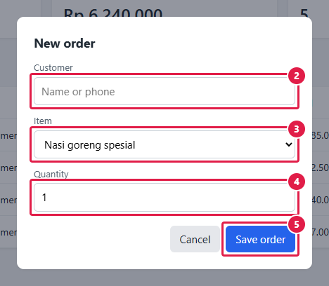
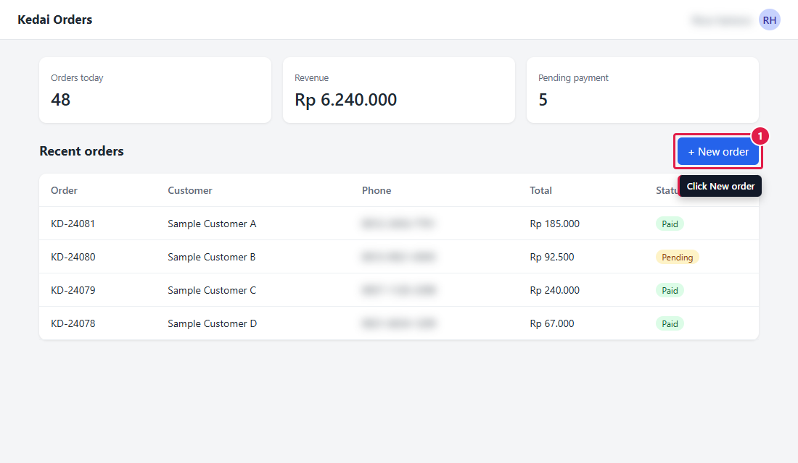

# 7. Menyimpan teks panduan bersama screenshot

[English](guide-text.md) · **Bahasa Indonesia**

GuShot tidak menulis panduan Anda, tetapi bisa menyimpan bagian teks yang melekat pada gambar (keterangan gambar dan langkah bernomor) di config yang sama dengan gambarnya. Setelah UI berubah, cukup jalankan satu perintah dan keduanya diperbarui.

## Config

[example.json](example.json) menambahkan tiga hal pada yang sudah dibahas di tutorial 3:

```json
"replaceText": { "Budi Santoso": "Sample Customer A", "Siti Aminah": "Sample Customer B" },
"shots": [
  { "name": "01_orders", "caption": "The Recent orders page",
    "steps": [{ "waitText": "Recent orders" }, { "waitText": "New order" }],
    "highlight": [{ "selector": "#new-order", "label": "1", "note": "Click New order" }] },
  { "name": "02_order_form", "caption": "Filling in a new order",
    "highlight": [
      { "selector": "#cust", "label": "2", "text": "Choose the Customer" },
      { "selector": ".modal .primary", "label": "5", "text": "Click Save order" }
    ] }
]
```

- `caption` (alias `keterangan`) adalah keterangan gambar, cukup ditulis sekali.
- `note` pada penanda digambar di gambar dan ikut masuk ke teks. `text` (alias `teks`) hanya masuk ke teks. Pakai `text` pada form yang padat, karena callout bisa menutupi label kolom.
- `replaceText` (alias `gantiTeks`) mengganti nama asli dengan nama contoh. Berbeda dengan blur, kolomnya tetap bisa dibaca.
- Tambahkan `waitText` untuk setiap label yang disebut di langkah. Kalau aplikasi mengganti nama "New order", `--check` gagal di shot ini.

## Jalankan

```bash
cd docs/guide-text
APP_PASSWORD=demo node ../../skills/guide-screenshots/scripts/shot.cjs example.json --md guide-skeleton.md
```

[guide-skeleton.md](guide-skeleton.md) berisi satu bagian per shot:

```markdown
## 02_order_form



*Filling in a new order*

2. Choose the Customer
3. Choose the Item
4. Enter the Quantity
5. Click Save order
```

Dengan `"guide": { "version": "1.0" }` di config (seperti di contoh ini), kerangka diawali front matter (`version`, `date`) yang bisa dicetak di sampul oleh pembuat PDF atau situs, dan menyarankan satu baris riwayat revisi. Kalau gambar berubah tapi versinya tetap, GuShot mengingatkan untuk menaikkannya.

Kerangka juga memuat baris seperti `> GuShot run 2026-10-15: changed: 02_order_form` (dengan `"lang": "id"`: `> Run GuShot 2026-10-15: berubah: 02_order_form`). Pakai baris ini untuk riwayat revisi panduan: naikkan versi dokumen dan tambahkan satu baris untuk bagian yang memakai gambar tersebut.

Kerangka ini ditimpa setiap kali dijalankan. Salin isinya ke panduan yang sebenarnya, lalu tulis bagian lainnya (tujuan, hasil, penjelasan) di sana. Setelah UI berubah, jalankan ulang dan bandingkan kerangka dengan git untuk melihat langkah mana yang berubah.

| 01_orders | 02_order_form |
|---|---|
|  |  |

## Menomori gambar

Tulis keterangan tanpa nomor, biar GuShot yang menghitung:

```json
"captionNumber": "Gambar {chapter}.{n}",
"shots": [
  { "name": "01_orders", "chapter": 2, "caption": "Halaman Recent orders" },
  { "name": "02_order_form", "caption": "Mengisi pesanan baru", "skipNumbers": 1 }
]
```

Hasilnya "Gambar 2.1 Halaman Recent orders" dan "Gambar 2.3 Mengisi pesanan baru". Nomor 2.2 disisakan untuk diagram yang ditulis di panduan. Kalau ada shot baru di tengah, nomor setelahnya ikut bergeser sendiri; jalankan `--guide` untuk menemukan keterangan di panduan yang masih memakai nomor lama.

## Menampilkan versi di sampul

Salin front matter dari kerangka ke bagian paling atas panduan (tidak boleh ada apa pun sebelum `---` pertama). Sebagian besar alat Markdown bisa membacanya:

| Alat | Cara menampilkan versi |
|---|---|
| Pandoc | blok ini menjadi metadata dokumen; template PDF bawaan mencetak `date` di halaman judul. Untuk versi, pakai `$version# 7. Menyimpan teks panduan bersama screenshot

[English](guide-text.md) · **Bahasa Indonesia**

GuShot tidak menulis panduan Anda, tetapi bisa menyimpan bagian teks yang melekat pada gambar (keterangan gambar dan langkah bernomor) di config yang sama dengan gambarnya. Setelah UI berubah, cukup jalankan satu perintah dan keduanya diperbarui.

## Config

[example.json](example.json) menambahkan tiga hal pada yang sudah dibahas di tutorial 3:

```json
"replaceText": { "Budi Santoso": "Sample Customer A", "Siti Aminah": "Sample Customer B" },
"shots": [
  { "name": "01_orders", "caption": "The Recent orders page",
    "steps": [{ "waitText": "Recent orders" }, { "waitText": "New order" }],
    "highlight": [{ "selector": "#new-order", "label": "1", "note": "Click New order" }] },
  { "name": "02_order_form", "caption": "Filling in a new order",
    "highlight": [
      { "selector": "#cust", "label": "2", "text": "Choose the Customer" },
      { "selector": ".modal .primary", "label": "5", "text": "Click Save order" }
    ] }
]
```

- `caption` (alias `keterangan`) adalah keterangan gambar, cukup ditulis sekali.
- `note` pada penanda digambar di gambar dan ikut masuk ke teks. `text` (alias `teks`) hanya masuk ke teks. Pakai `text` pada form yang padat, karena callout bisa menutupi label kolom.
- `replaceText` (alias `gantiTeks`) mengganti nama asli dengan nama contoh. Berbeda dengan blur, kolomnya tetap bisa dibaca.
- Tambahkan `waitText` untuk setiap label yang disebut di langkah. Kalau aplikasi mengganti nama "New order", `--check` gagal di shot ini.

## Jalankan

```bash
cd docs/guide-text
APP_PASSWORD=demo node ../../skills/guide-screenshots/scripts/shot.cjs example.json --md guide-skeleton.md
```

[guide-skeleton.md](guide-skeleton.md) berisi satu bagian per shot:

```markdown
## 02_order_form


*Filling in a new order*

2. Choose the Customer
3. Choose the Item
4. Enter the Quantity
5. Click Save order
```

Dengan `"guide": { "version": "1.0" }` di config (seperti di contoh ini), kerangka diawali front matter (`version`, `date`) yang bisa dicetak di sampul oleh pembuat PDF atau situs, dan menyarankan satu baris riwayat revisi. Kalau gambar berubah tapi versinya tetap, GuShot mengingatkan untuk menaikkannya.

Kerangka juga memuat baris seperti `> GuShot run 2026-10-15: changed: 02_order_form` (dengan `"lang": "id"`: `> Run GuShot 2026-10-15: berubah: 02_order_form`). Pakai baris ini untuk riwayat revisi panduan: naikkan versi dokumen dan tambahkan satu baris untuk bagian yang memakai gambar tersebut.

Kerangka ini ditimpa setiap kali dijalankan. Salin isinya ke panduan yang sebenarnya, lalu tulis bagian lainnya (tujuan, hasil, penjelasan) di sana. Setelah UI berubah, jalankan ulang dan bandingkan kerangka dengan git untuk melihat langkah mana yang berubah.

| 01_orders | 02_order_form |
|---|---|
|  |  |

 di template sendiri (`pandoc panduan.md -o panduan.pdf --template sampul.tex`) |
| VitePress | tulis `Versi {{ $frontmatter.version }}` di halaman |
| MkDocs | pakai `{{ page.meta.version }}` di template override tema |
| Script sendiri | baca baris di antara dua `---` pertama sebagai `kunci: nilai`, lalu buang bloknya sebelum Markdown dikonversi |

Pakai `date` dari front matter, bukan tanggal saat PDF dibuat, supaya build ulang tanpa perubahan tetap bertanggal sama.

Cara menyusun teksnya sendiri (jenis subbab, satu skenario utama, kapan penanda wajib) ada di [writing.md](../../skills/guide-screenshots/references/writing.md).
