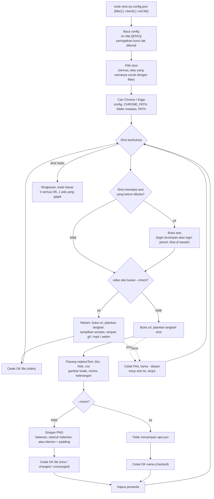
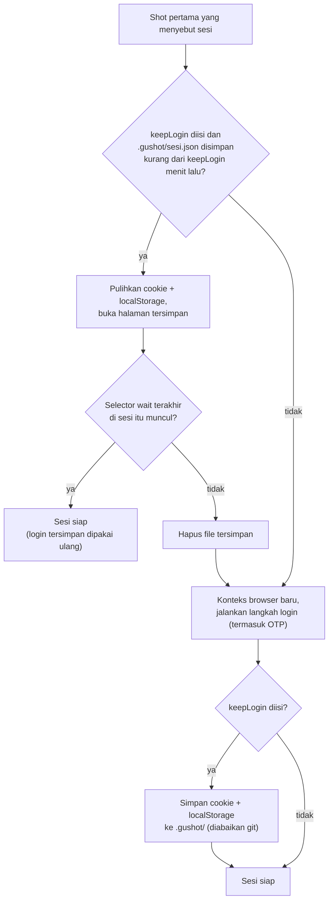
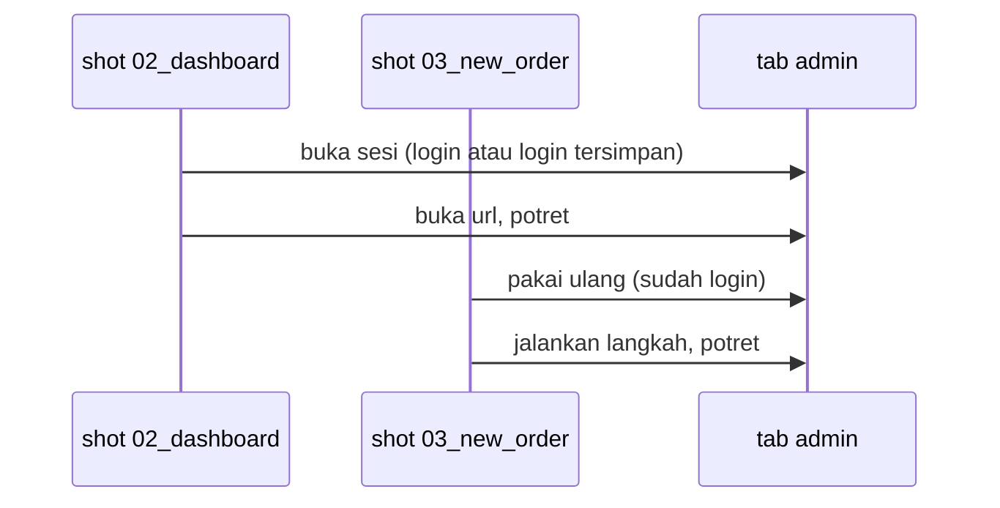

# Cara kerja GuShot

[English](how-it-works.md) · **Bahasa Indonesia**

GuShot membaca satu config JSON lalu menjalankan Chrome atau Edge yang sudah terpasang sesuai isi config itu. Anda tidak menulis kode browser; cukup jelaskan halaman dan langkahnya, GuShot yang mengubahnya menjadi file PNG, atau video untuk shot yang memintanya.

## Alur lengkap

## Membuka sesi

Sesi adalah daftar langkah login. Sesi dijalankan sekali per run; shot berikutnya yang menyebut sesi itu memakai ulang tab yang sudah login. Kalau `"keepLogin"` diisi, login juga bisa dipakai ulang antar-run.

Shot dengan `"freshSession": true` membuka ulang sesinya di konteks browser baru (dengan `keepLogin`, dari login tersimpan). Kalau sebuah shot gagal, sesinya ditutup supaya shot berikutnya mulai dari keadaan bersih.

## Tiga hal lain yang perlu diingat

**Path dihitung dari file config.** `out`, `otp.file`, `cwd` milik langkah `run`, halaman lokal seperti `"./app.html"`, `chrome`, `ffmpeg`, dan folder `.gushot/` semuanya dihitung dari folder tempat file config berada, bukan dari tempat Anda menjalankan perintah.

**Penanda bersifat sementara.** Blur, elemen yang disembunyikan, kotak sorot, nomor, dan keterangan dipasang tepat sebelum memotret lalu dihapus tepat setelahnya, jadi tidak terbawa ke shot berikutnya. Pengecualiannya `replaceText`: teks halaman itu sendiri yang diganti, jadi teks contoh tetap ada sampai ada shot yang membuka `url` lagi.

**Kerangka Markdown ditulis paling akhir.** Dengan `--md`, setelah browser ditutup, GuShot menulis satu bagian per shot yang berhasil (`caption`, path gambar relatif terhadap file Markdown, `text` atau `note` sorotan sebagai langkah bernomor). Bagian ini tidak butuh browser, jadi tetap jalan dengan `--check`. Lihat [tutorial 7](../guide-text/guide-text.id.md).

**Video menjaga blur di setiap frame.** Untuk shot `video`, blur, hide, dan css tambahan dipasang sebelum perekaman dimulai dan dipasang lagi begitu setiap halaman baru dimuat, jadi data pribadi tidak sempat terlihat saat pindah halaman. Lihat [tutorial 6](../video/record-a-flow.id.md).

Berikutnya: [1. Screenshot pertama](../getting-started/first-screenshots.id.md)
