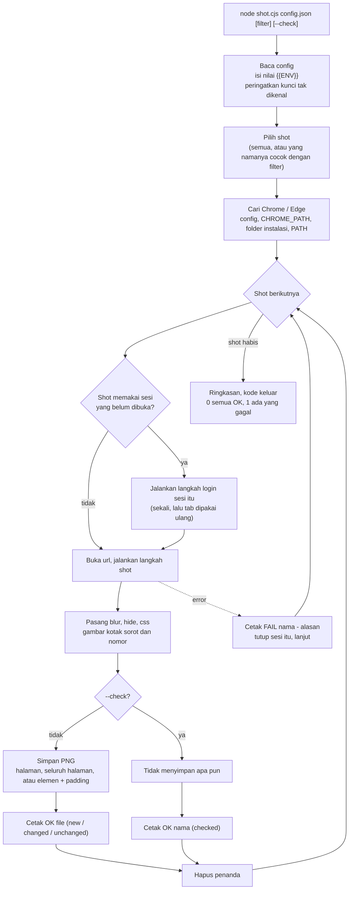
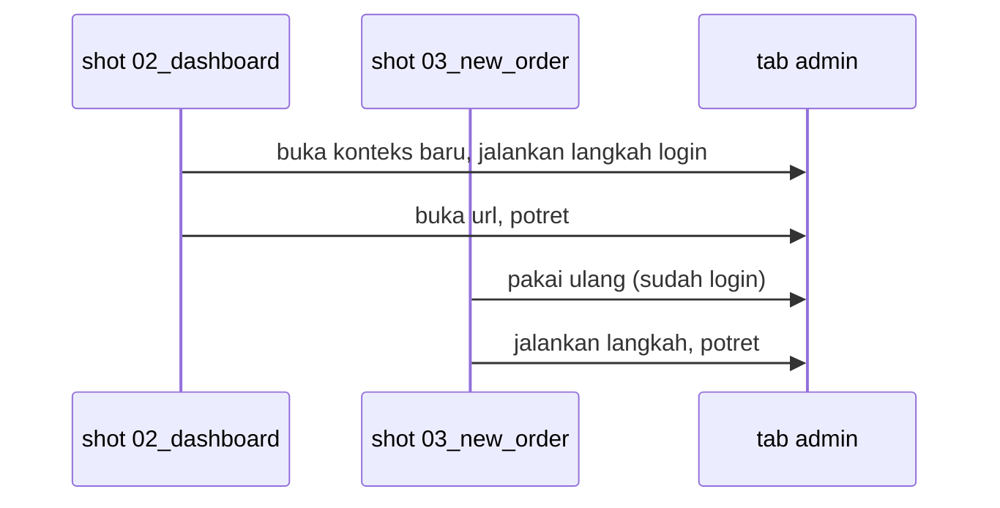

# Cara kerja GuShot

[English](how-it-works.md) · **Bahasa Indonesia**

GuShot membaca satu config JSON lalu menjalankan Chrome atau Edge yang sudah terpasang sesuai isi config itu. Anda tidak menulis kode browser; cukup jelaskan halaman dan langkahnya, GuShot yang mengubahnya menjadi file PNG.

## Alur lengkap

## Tiga hal yang perlu diingat

**Sesi login sekali saja.** Sesi adalah daftar langkah login. Shot pertama yang menyebut sesi itu menjalankan langkahnya di konteks browser baru; shot berikutnya memakai ulang tab yang sudah login. Shot dengan `"freshSession": true` login ulang dulu. Kalau sebuah shot gagal, sesinya ditutup supaya shot berikutnya mulai dari keadaan bersih.

**Path dihitung dari file config.** `out`, `otp.file`, `cwd` milik langkah `run`, halaman lokal seperti `"./app.html"`, dan `chrome` semuanya dihitung dari folder tempat file config berada, bukan dari tempat Anda menjalankan perintah.

**Penanda bersifat sementara.** Blur, elemen yang disembunyikan, kotak sorot, dan nomor dipasang tepat sebelum memotret lalu dihapus tepat setelahnya, jadi tidak terbawa ke shot berikutnya.

Berikutnya: [1. Screenshot pertama](../getting-started/first-screenshots.id.md)
