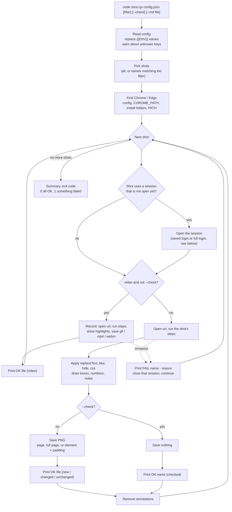
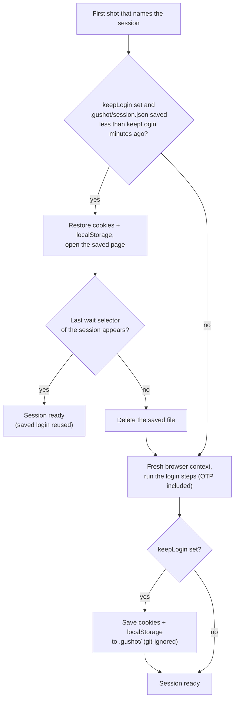
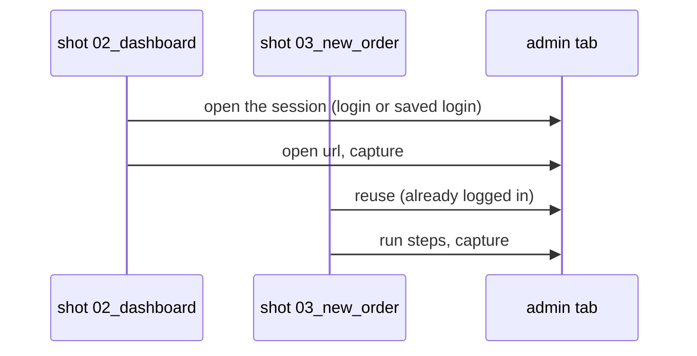

# How GuShot works

**English** · [Bahasa Indonesia](how-it-works.id.md)

GuShot reads one JSON config and drives your installed Chrome or Edge through it. You never write browser code; you describe pages and steps, and GuShot turns them into PNG files, or videos for shots that ask for one.

## The whole run

## Opening a session

A session is a list of login steps. It runs once per run; every later shot that names it reuses the logged-in tab. With `"keepLogin"` set, the login can also be reused across runs.

A shot with `"freshSession": true` starts its session again in a new browser context (with `keepLogin`, from the saved login). If a shot fails, its session is closed so the next shot starts clean.

## Three more things to keep in mind

**Paths are relative to the config file.** `out`, `otp.file`, a `run` step's `cwd`, a local page like `"./app.html"`, `chrome`, `ffmpeg`, and the `.gushot/` folder all resolve from the folder that holds the config, not from where you run the command.

**Annotations are temporary.** Blur, hidden elements, highlight boxes, numbers, and notes are added right before the capture and removed right after, so they never leak into the next shot. `replaceText` is the exception: it changes the page text itself, so the sample text stays until a shot opens a `url` again.

**The Markdown skeleton comes last.** With `--md`, after the browser closes, GuShot writes one section per successful shot (`caption`, image path relative to the Markdown file, highlight `text` or `note` as numbered steps). It needs no browser, so it works with `--check` too. See [tutorial 7](../guide-text/guide-text.md).

**Videos keep blur on every frame.** For a `video` shot, blur, hide, and extra css are added before recording starts and again as soon as each new page loads, so private data does not flash by between pages. See [tutorial 6](../video/record-a-flow.md).

Next: [1. Your first screenshots](../getting-started/first-screenshots.md)
