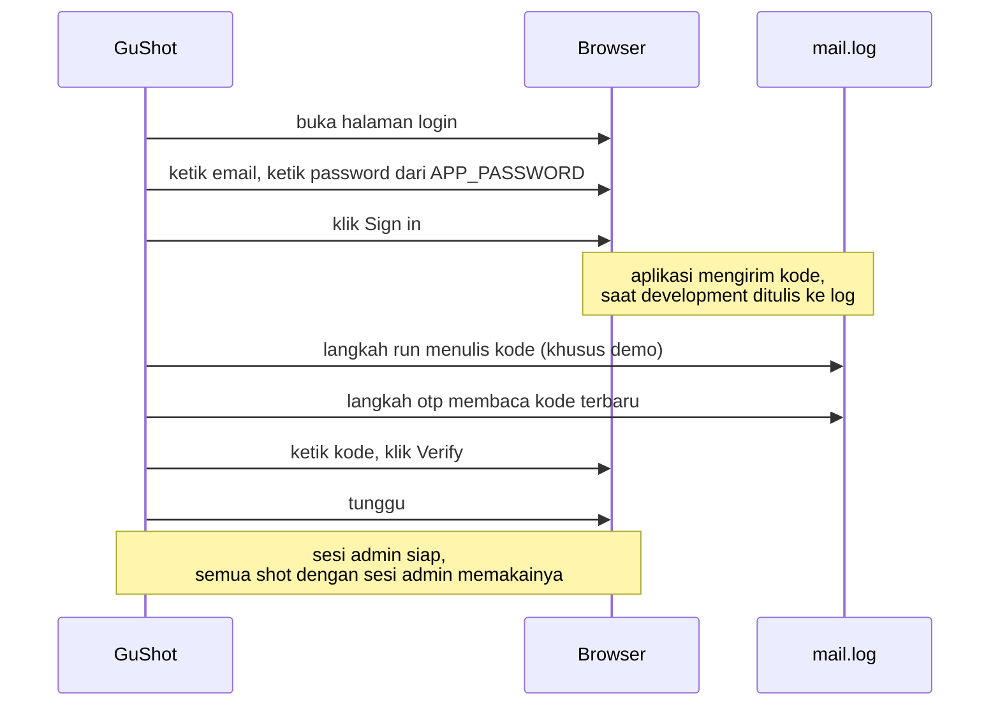
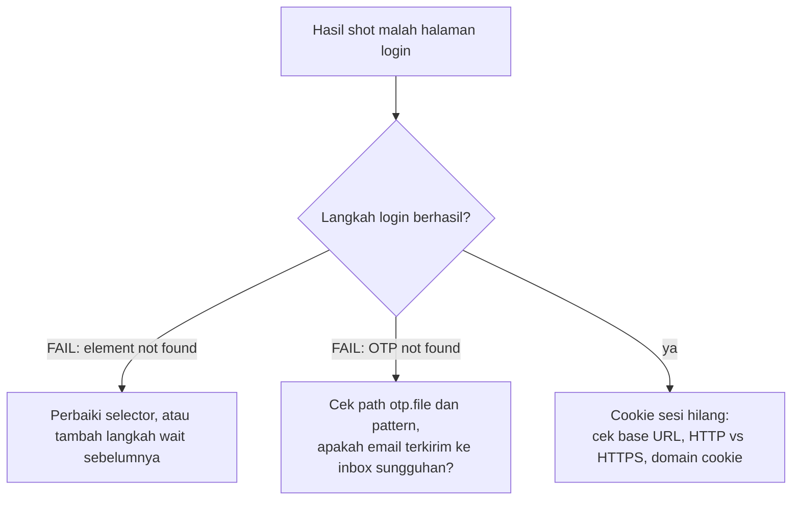

# 2. Login, termasuk OTP

[English](login-and-otp.md) · **Bahasa Indonesia**

Sebagian besar halaman yang dibahas panduan ada di balik login. Di tutorial ini Anda login sekali dengan password dari environment, mengisi kode OTP yang ditulis aplikasi ke file log, lalu memotret halaman sebagai pengguna yang sudah login.

## Alur login



## Config

[example.json](example.json) di folder ini:

```json
{
  "out": "screenshots",
  "viewport": { "width": 1100, "height": 640 },
  "alwaysBlur": [".customer", ".phone", ".contact"],
  "sessions": {
    "admin": [
      { "open": "../../demo/app.html" },
      { "type": "#email", "text": "rina@kedai.example" },
      { "type": "#password", "text": "{{APP_PASSWORD}}" },
      { "click": "#login button" },
      { "run": "node -e \"require('fs').appendFileSync('mail.log','Your Kedai code: 482913\\n')\"" },
      { "otp": { "file": "mail.log", "pattern": "Kedai code: (\\d{6})", "into": "#code", "submit": { "clickText": "Verify" } } },
      { "wait": "#app" }
    ]
  },
  "shots": [
    { "name": "01_otp_page", "url": "../../demo/app.html", "steps": [
      { "type": "#email", "text": "rina@kedai.example" },
      { "type": "#password", "text": "{{APP_PASSWORD}}" },
      { "click": "#login button" },
      { "wait": "#code" }
    ] },
    { "name": "02_dashboard", "session": "admin" }
  ]
}
```

Fungsi tiap bagian:

- **`sessions.admin`** adalah langkah login, ditulis sekali. Beri nama sesi sesuai peran (`admin`, `kasir`, `pelanggan`) kalau panduan mencakup beberapa peran.
- **`{{APP_PASSWORD}}`** diganti dengan isi variabel environment `APP_PASSWORD`. Password tidak pernah ditulis di file.
- **`run`** menulis kode ke `mail.log`. Aplikasi demo tidak punya server email, jadi langkah ini menggantikannya. Di aplikasi Anda langkah ini tidak perlu, karena aplikasinya sendiri yang menulis kode.
- **`otp`** menunggu baris yang cocok dengan `pattern` di `file`, mengambil grup tangkapan pertama (bagian `(\d{6})`), mengetikkannya ke `into`, lalu menjalankan `submit`. Hanya baris yang ditulis setelah langkah sebelumnya yang dibaca, jadi kode lama tidak akan terpakai.
- **`01_otp_page`** tidak memakai sesi: shot ini memperlihatkan halaman antara password dan kode, supaya panduan bisa menjelaskan langkah itu.
- **`02_dashboard`** memakai sesi, jadi langsung dalam keadaan login.

## Jalankan

```bash
cd docs/login
APP_PASSWORD=demo node ../../skills/guide-screenshots/scripts/shot.cjs example.json
```

PowerShell: `$env:APP_PASSWORD='demo'; node ../../skills/guide-screenshots/scripts/shot.cjs example.json`

## Hasil

| `01_otp_page.png` | `02_dashboard.png` |
|---|---|
|  |  |

Alamat email, nama pelanggan, nomor HP, dan nama pengguna di-blur oleh `alwaysBlur`. Tutorial 3 membahasnya.

## Untuk aplikasi Anda sendiri

1. **Cari selector yang sebenarnya.** Buka halaman login, klik kanan kolom email, pilih Inspect. Utamakan `#id` atau `[name=email]` daripada rangkaian class yang panjang.
2. **Cari ke mana kode dikirim saat development.** Laravel dengan `MAIL_MAILER=log` menulis email ke `storage/logs/laravel.log`; banyak aplikasi mencetaknya ke log konsol. Arahkan `otp.file` ke sana dan tulis `pattern` yang cocok dengan barisnya, misalnya `"Your code is (\\d{6})"`.
3. **Samakan URL dasar aplikasi dengan `base`.** Kalau aplikasi mengira dirinya berada di host lain, CSS dan cookie-nya rusak.
4. **Waspadai batas percobaan login.** Tambahkan langkah `run` yang mengosongkan pembatasnya (misalnya `php artisan cache:clear`) di awal sesi.



Berikutnya: [3. Blur, sembunyikan, sorot, beri nomor](../annotations/blur-highlight-numbering.id.md)
