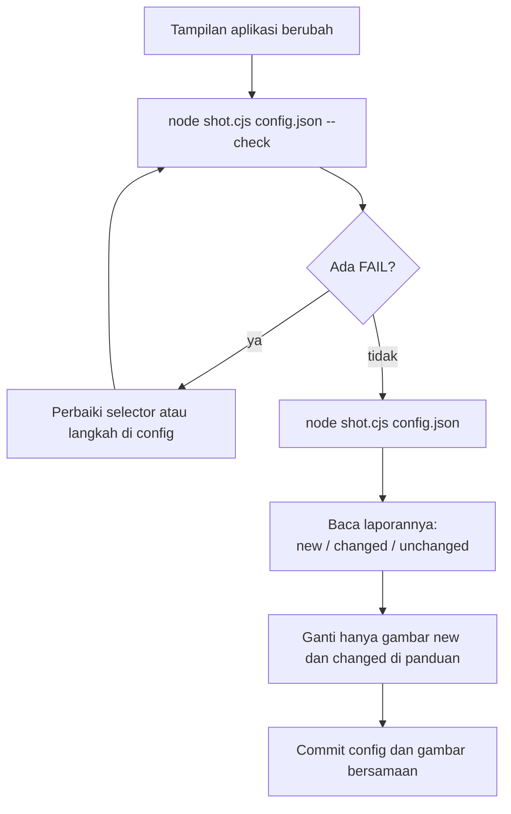
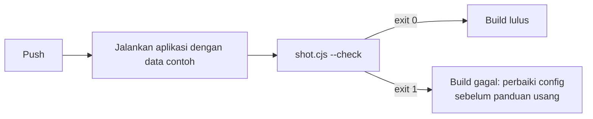

# 4. Menjaga screenshot tetap terbaru

[English](update-after-ui-change.md) · **Bahasa Indonesia**

Keunggulan config dibanding screenshot manual terasa saat menjalankan ulang. Ketika aplikasi berubah, Anda cukup menjalankan GuShot lagi, tidak perlu memotret ulang semua gambar. Tutorial ini menunjukkan cara mengetahui yang berubah, memperbarui gambar itu saja, dan menangkap selector yang rusak sebelum panduan ikut rusak.

## Siklus pembaruan



## Langkah 1: periksa tanpa menyimpan

`--check` menjalankan semua login dan langkah serta memastikan setiap `element` ada, tapi tidak menulis file apa pun. Gambar yang sekarang tetap utuh selama Anda memperbaiki config.

```bash
cd docs/annotations
APP_PASSWORD=demo node ../../skills/guide-screenshots/scripts/shot.cjs example.json --check
```

```
OK    01_highlight_button (checked, not saved)
OK    02_hide_stats (checked, not saved)
OK    03_numbered_form (checked, not saved)

Done: 3 OK, 0 failed. Output in .../docs/annotations/screenshots
```

Kalau ada selector yang rusak, muncul baris `FAIL` beserta alasannya dan kode keluar 1:

```
FAIL  03_numbered_form - element .modal not found
```

## Langkah 2: potret dan baca laporannya

Untuk melihat perubahan nyata, buka [../../demo/app.html](../../demo/app.html) di editor dan ganti judul `Recent orders` menjadi `Latest orders`. Lalu potret:

```bash
APP_PASSWORD=demo node ../../skills/guide-screenshots/scripts/shot.cjs example.json
```

```
OK    screenshots/01_highlight_button.png (changed)
OK    screenshots/02_hide_stats.png (changed)
OK    screenshots/03_numbered_form.png (unchanged)

Done: 3 OK, 0 failed. Output in .../docs/annotations/screenshots
Changed: 2, new: 0.
```

Setiap file dibandingkan dengan file lama yang ditimpanya. Dua shot dasbor memperlihatkan judul baru, jadi itulah gambar yang perlu diganti di panduan. `03_numbered_form.png` tidak berubah karena judul itu tertutup modal. Kalau gambar disimpan di git, `git diff --stat` menunjukkan daftar yang sama.

Setelah selesai, batalkan perubahannya (`git checkout demo/app.html`) lalu jalankan lagi untuk mengembalikan gambarnya.

## Langkah 3: jalankan ulang yang perlu saja

Filter hanya menjalankan shot yang namanya mengandung teks tersebut:

```bash
APP_PASSWORD=demo node ../../skills/guide-screenshots/scripts/shot.cjs example.json 03          # hanya 03_numbered_form
APP_PASSWORD=demo node ../../skills/guide-screenshots/scripts/shot.cjs example.json button hide  # 01 dan 02
```

## Teks panduan

Kalau shot memakai `caption` dan `text` langkah ([tutorial 7](../guide-text/guide-text.id.md)), tambahkan `--md kerangka.md` saat menjalankan, lalu bandingkan kerangka dengan git: bagian yang berubah adalah teks yang perlu diperbarui. Langkah `waitText` untuk setiap label yang dikutip panduan membuat `--check` gagal kalau aplikasi mengganti nama label itu.

## Tangkap kerusakan di CI

Jalankan `--check` setiap push, supaya tombol yang namanya berubah membuat build gagal, bukan diam-diam merusak panduan. Contoh job GitHub Actions, dengan asumsi aplikasi Anda bisa dijalankan di CI dengan data contoh:

```yaml
- run: npm ci && npm run seed && npm start &
- run: npx wait-on http://localhost:3000
- run: npm install --omit=dev --prefix path/to/guide-screenshots/scripts
- run: node path/to/guide-screenshots/scripts/shot.cjs docs/screenshots.json --check
  env:
    APP_PASSWORD: ${{ secrets.DOCS_DEMO_PASSWORD }}
```



## Kode keluar

| Kode | Arti |
|---|---|
| `0` | semua shot OK |
| `1` | minimal satu shot gagal; shot lain tetap dijalankan |
| `2` | `puppeteer-core` belum dipasang; pesannya menampilkan perintah pemasangan |

Berikutnya: [5. Dipakai lewat agen AI](../ai-agents/use-with-ai-agents.id.md)
