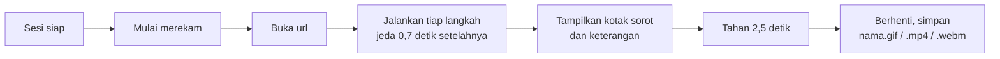

# 6. Merekam alur sebagai video

[English](record-a-flow.md) · **Bahasa Indonesia**

Beberapa langkah lebih mudah diikuti kalau pembaca melihatnya berlangsung: mengisi form, membuka menu, menyeret sesuatu. Shot dengan `"video"` merekam langkah-langkahnya sebagai MP4, GIF, atau WebM, bukan menyimpan PNG.


## Yang direkam



Blur, hide, dan `css` tambahan dipasang sebelum perekaman dimulai dan dipasang lagi tepat setelah setiap halaman dimuat, jadi data pribadi tetap ter-blur di setiap frame, termasuk saat pindah halaman.

## Sebelum mulai

Pasang [ffmpeg](https://ffmpeg.org/download.html) dan cek bisa jalan: `ffmpeg -version`. Kalau tidak ada di `PATH`, isi `"ffmpeg": "path/ke/ffmpeg"` di config. Tanpa ffmpeg, shot video gagal dengan pesan yang menjelaskannya; shot lain tetap berjalan.

## Config

[example.json](example.json) login seperti tutorial 2 lalu merekam satu alur:

```json
"shots": [
  { "name": "new_order", "session": "admin", "video": "gif",
    "steps": [
      { "click": "#new-order" },
      { "wait": ".modal" },
      { "type": "#cust", "text": "Walk-in customer" },
      { "select": "#menu", "value": "Mie ayam" },
      { "type": "#qty", "text": "2" }
    ],
    "highlight": [{ "selector": ".modal .primary", "note": "Last step: save the order" }] }
]
```

```bash
cd docs/video
APP_PASSWORD=demo node ../../skills/guide-screenshots/scripts/shot.cjs example.json
```

```
OK    videos/new_order.gif (video)
```

## Memilih format

| `video` | Cocok untuk | Catatan |
|---|---|---|
| `"gif"` | README, wiki, chat | diputar di mana saja, berulang, file lebih besar |
| `true` atau `"mp4"` | situs web, LMS, slide | file kecil, butuh pemutar video |
| `"webm"` | situs web | paling kecil, tidak didukung semua pemutar |

## Tips

- Satu video cukup untuk satu tugas dengan 3 sampai 8 langkah. Alur yang lebih panjang lebih enak dibaca sebagai screenshot bernomor.
- `viewport` yang lebih kecil (misalnya 900 x 560) menghasilkan GIF yang lebih kecil dan tajam.
- `--check` menjalankan langkah shot video tanpa merekam, sama seperti shot lain.
- Video di-encode ulang setiap kali dijalankan, jadi statusnya selalu `(video)`, bukan new/changed/unchanged.

## Tidak perlu login setiap kali menjalankan

Login dengan OTP di setiap run itu lambat. `"keepLogin": 60` di bagian atas config menyimpan login tiap sesi selama 60 menit: setelah login, GuShot menyimpan cookie dan localStorage ke `.gushot/<sesi>.json` di samping config, dan run berikutnya memulihkannya, tidak login lagi.

```
      (sesi "admin": login tersimpan dipakai ulang)
```

- Login tersimpan hanya dipakai kalau selector `wait` terakhir di sesi itu muncul. Kalau tidak, file-nya dihapus dan sesi login seperti biasa, jadi logout atau cookie kedaluwarsa hanya berarti satu kali login normal.
- Fitur ini bekerja untuk aplikasi yang menyimpan login di cookie atau localStorage, yaitu hampir semua aplikasi sungguhan. Aplikasi demo hanya menyimpannya di memori, jadi contoh di dokumentasi ini tidak memakainya.
- File itu berisi cookie sesi yang masih aktif. `.gushot/` otomatis punya `.gitignore` sendiri, tapi jangan aktifkan `keepLogin` di komputer bersama, dan hapus `.gushot/` untuk memaksa login ulang.

Kembali ke [daftar isi dokumentasi](../README.id.md).
