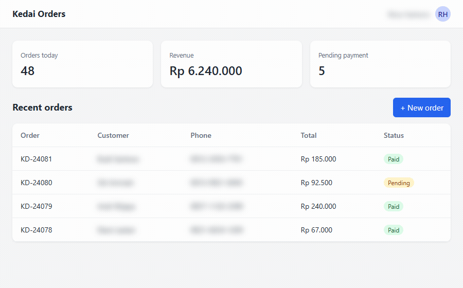
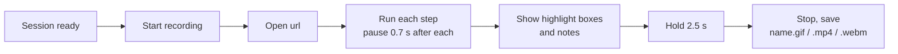

# 6. Recording a flow as a video

**English** · [Bahasa Indonesia](record-a-flow.id.md)

Some steps are easier to follow when the reader sees them happen: filling a form, opening a menu, dragging something. A shot with `"video"` records its steps as an MP4, GIF, or WebM instead of saving a PNG.



## What gets recorded



Blur, hide, and extra `css` are applied before recording starts and again right after every page load, so private data stays blurred in every frame, also between pages.

## Before you start

Install [ffmpeg](https://ffmpeg.org/download.html) and check it works: `ffmpeg -version`. If it is not on `PATH`, set `"ffmpeg": "path/to/ffmpeg"` in the config. Without ffmpeg the shot fails with a message that says so; other shots still run.

## The config

[example.json](example.json) logs in like tutorial 2 and records one flow:

```json
"shots": [
  { "name": "new_order", "session": "admin", "video": "gif",
    "steps": [
      { "click": "#new-order" },
      { "wait": ".modal" },
      { "type": "#cust", "text": "Walk-in customer" },
      { "select": "#menu", "value": "Mie ayam" },
      { "type": "#qty", "text": "2" }
    ],
    "highlight": [{ "selector": ".modal .primary", "note": "Last step: save the order" }] }
]
```

```bash
cd docs/video
APP_PASSWORD=demo node ../../skills/guide-screenshots/scripts/shot.cjs example.json
```

```
OK    videos/new_order.gif (video)
```

## Choosing a format

| `video` | Use for | Notes |
|---|---|---|
| `"gif"` | README files, wikis, chat | plays everywhere, loops, larger files |
| `true` or `"mp4"` | websites, LMS, slides | small files, needs a video player |
| `"webm"` | websites | smallest, not supported by every viewer |

## Tips

- Keep a video to one task of 3 to 8 steps. Longer flows read better as numbered screenshots.
- A smaller `viewport` (for example 900 x 560) gives smaller, sharper GIFs.
- `--check` runs a video shot's steps without recording, like any other shot.
- Videos are re-encoded on every run, so they always report `(video)` instead of new/changed/unchanged.

## Skipping the login on every run

Logging in with an OTP on every run is slow. `"keepLogin": 60` at the top of a config keeps each session's login for 60 minutes: after logging in, GuShot saves the cookies and localStorage to `.gushot/<session>.json` next to the config, and the next run restores them instead of logging in.

```
      (session "admin": saved login reused)
```

- The saved login is trusted only if the session's last `wait` selector appears. Otherwise it is deleted and the session logs in normally, so a logout or an expired cookie costs one normal login, nothing more.
- It works for apps that keep the login in cookies or localStorage, which is almost every real app. The demo app keeps it only in memory, so the examples in these docs do not use it.
- The file contains live session cookies. `.gushot/` gets its own `.gitignore`, but do not enable `keepLogin` on a shared machine, and delete `.gushot/` to force a fresh login.

Back to the [docs index](../README.md).
